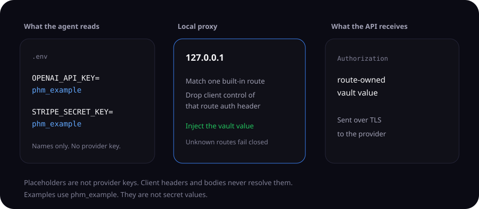
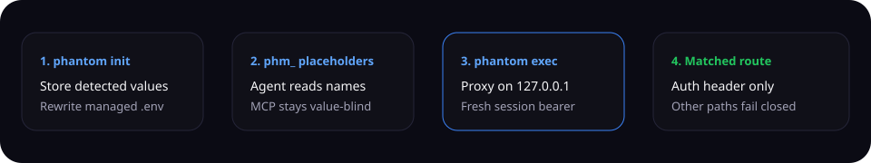
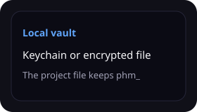
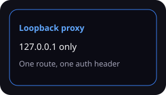
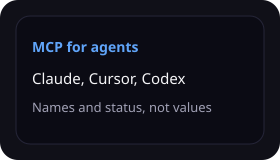
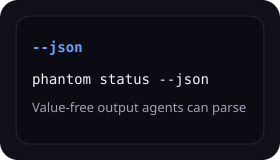

<div align="center">

# Phantom

**Your agent can call the API. The key stays in a local vault.**

Phantom replaces managed secrets in `.env` with `phm_` placeholders. Agents and apps read those placeholders. A proxy on `127.0.0.1` adds the vault value only to the auth header of a matched route.

[](https://github.com/ashlrai/phantom-secrets)
[](https://github.com/ashlrai/phantom-secrets/actions/workflows/ci.yml)
<!-- fresh:begin readme-release-badges -->
[](https://github.com/ashlrai/phantom-secrets/releases/tag/v0.7.9)
[](CHANGELOG.md#083---2026-11-06)
<!-- fresh:end -->

Source `0.8.3` is a release candidate. The verified public GitHub release remains `v0.7.9`; source metadata does not establish publication.

[](rust-toolchain.toml)
[](LICENSE)

[**Quick start**](#quick-start) ·
[**Why Phantom?**](#why-phantom) ·
[**How it works**](#how-it-works) ·
[**MCP setup**](#mcp-integration-claude-code-cursor-windsurf-codex) ·
[**llms.txt**](docs/llms.txt) ·
[**Docs**](docs/README.md) ·
[**Star on GitHub**](https://github.com/ashlrai/phantom-secrets)

</div>



## Quick start

About 30 seconds. Paste the blocks below. They are the same commands an agent should run. None of them print a secret value.

### Install on macOS

```bash
brew tap ashlrai/phantom && brew trust --formula ashlrai/phantom/phantom && brew install ashlrai/phantom/phantom
```

Linux and Windows: paste the checksum-checked script in [Installation](#installation). Package channels and their limits are in [distribution status](docs/distribution-status.md).

### Commands

```bash
phantom init
phantom status --json
phantom list --json
phantom agent doctor --json
phantom setup --client claude
phantom setup --client cursor
phantom setup --client codex
phantom check
phantom check --log agent-transcript.jsonl --json
phantom why OPENAI_API_KEY --json
```

`phantom check --log` reads one agent transcript or log and reports the file, the line, and the credential shape. It does not print the secret. The same scan is the MCP tool `phantom_check` with `log_path`.

`phantom status --json`, `phantom list --json`, and `phantom why OPENAI_API_KEY --json` are value-free. `phantom setup` writes that client's MCP config. Install both verified `v0.7.9` binaries first. Version `0.7.9` has no network package-runner fallback and fails closed when neither local runtime is executable.

Machine-readable docs for agents:

- [docs/llms.txt](docs/llms.txt)
- [docs/llms-full.txt](docs/llms-full.txt)
- [https://phm.dev/llms.txt](https://phm.dev/llms.txt)
- [https://phm.dev/llms-full.txt](https://phm.dev/llms-full.txt)

### MCP config

Claude Code writes project `.mcp.json`. Cursor writes `~/.cursor/mcp.json`. Both use this shape. `phantom setup` fills `command` with the absolute path it found. This copy uses `phantom` on `PATH`:

```json
{
  "mcpServers": {
    "phantom": {
      "command": "phantom",
      "args": ["mcp", "serve"]
    }
  }
}
```

Codex writes `~/.codex/config.toml`:

```toml
[mcp_servers.phantom]
command = "phantom"
args = ["mcp", "serve"]
```

Restart the client, then ask it to call `phantom_status` and `phantom_list_secrets`. Do not ask it to reveal values.


## Why Phantom?

Coding agents read the repo. A real API key in `.env` can land in a transcript, a tool call, or a file the agent writes. Phantom moves managed values into a local vault and leaves `phm_` placeholders behind.

That covers the managed dotenv and the value-blind MCP path. It does not cover unmanaged files, other processes running as you, or a process that already holds the live proxy bearer. Those stay in the [threat model](THREAT_MODEL.md).

- Local setup does not need an account, a DNS change, or a custom CA.
- Claude Code, Cursor, Windsurf, Codex, and Gemini CLI each have a setup command.
- The vault uses the OS credential store when it can, and an encrypted file when it cannot.
- Linux keyutils entries do not survive a reboot. A headed Linux desktop can run `phantom vault migrate-linux` from a trusted terminal to copy the project vault into Secret Service.

## How it works



1. `phantom init` stores detected values and rewrites the managed `.env` with `phm_` placeholders.
2. `phantom exec -- claude` starts a proxy on `127.0.0.1`, sets supported `*_BASE_URL` values, and launches the command.
3. A matched route gets only that route's vault value in its fixed auth header. Client headers and bodies never resolve placeholders.
4. When the session ends, that proxy bearer stops working. Project placeholders stay until you rotate them. They are not provider keys.

## What you get

|  |  |  |  |
| --- | --- | --- | --- |
| Detected values move into the OS credential store or an encrypted file. | `phantom exec` injects one route's key and forwards over TLS. | Agents list names and status. Effectful tools stay off unless you approve them outside the agent. | `phantom status --json` and `phantom list --json` are safe for scripts. |

The full command list is in [Command reference](#command-reference).

## FAQ

### Does the agent see the provider key?

On the supported path, the managed `.env` and MCP tools show placeholders and names. The proxy adds the vault value on a matched route. An unmanaged file is still readable. A process that controls the live proxy can call the routes that proxy allows.

### Do I need Phantom Cloud?

No. `phantom init` works on this machine. Cloud backup is a separate hosted service and is not required for local use.

### Which clients get an MCP config?

`phantom setup --client claude`, `phantom setup --client cursor`, `phantom setup --client windsurf`, `phantom setup --client codex`, and `phantom setup --client gemini`. `phantom setup --client claude --print` prints a snippet for any other client.

### What should an agent run first?

`phantom status --json`, `phantom list --json`, and `phantom check`. Then `phantom why OPENAI_API_KEY --json` for a specific name. Those commands do not print secret values.

### Where do Windows and Linux installs live?

Use the matching [v0.7.9 archive](#exact-v079-github-assets), check its `.sha256` file, and put both `phantom` and `phantom-mcp` on `PATH`. Windows archives are not Authenticode-signed. The pre-commit hook is a `#!/bin/sh` script, so run commits from a terminal that has Git's `sh.exe`, or run `phantom check --staged`.

## Star Phantom

If this kept a key out of an agent transcript, star the repo so the next person can find it.

**[Star ashlrai/phantom-secrets on GitHub](https://github.com/ashlrai/phantom-secrets)**

## What a scripted check measured

Reproduce with `python3 eval/leak-rate/harness.py 5` (about 3 minutes, Linux, phantom 0.7.9; fake canary keys only, no paid keys). Method and limits: [eval/leak-rate/README.md](eval/leak-rate/README.md).

| setup | in-boundary attacks that exposed a canary key |
| --- | --- |
| plain `.env`, no protection | 210 of 450 |
| after `phantom init` | **0 of 450** |

450 = 30 attack techniques x 3 secrets x 5 runs (`cat .env`, `printenv`, `/proc/self/environ`, base64 and hex dumps, `git add -f`, `ps eww`, `phantom reveal`/`export`/`exec`, every MCP tool called with `confirm=true`, and a README prompt injection the scripted agent obeys). Per-technique table: [eval/leak-rate/table.md](eval/leak-rate/table.md).

What this does not show: it is a scripted worst case, not an LLM, so it measures where a key can appear, not how often a model goes looking. One out-of-scope case is reported separately: an unmanaged key file the developer never put in `.env` stays readable (15 of 15 in both setups). Same-user access to the OS keychain is outside the documented boundary and is not tested. Proxy use of a key on an allowed route is by design. One machine, no external audit.

## Provider grants

`phantom grant` retains value-blind lifecycle metadata and provider protocol
design foundations. In 0.7.9, all live provider issuance, enrollment exchange,
refresh, renewal, and revocation execution is hard-denied before Phantom reads a
provider credential or opens a provider network connection. Do not use grant or
rotation commands expecting a vendor-side change. Test-only mocks demonstrate
local transaction behavior only; they are not live-provider acceptance.

In these docs, **provider grant** means design-era credential lifecycle metadata;
no live grant flow runs in 0.7.9. **Authority grant** means the inactive, value-free execution
authority type in `phantom-authority`. A provider grant cannot be reinterpreted
as an authority grant, Locus credential, broker lease, or execution permit. See
the [design-era grant lifecycle specification](docs/grants-spec.md); the
[issuance contract](ISSUANCE_CONTRACT.md) is the original design contract and
retains design-era status language.

## MCP Integration (Claude Code, Cursor, Windsurf, Codex)

Phantom ships an MCP server so AI coding tools can inspect value-blind metadata
and request gated lifecycle operations. MCP responses do not return real secret
values.

### First MCP task: verify the boundary

Use this read-only path before exploring the full tool catalog:

1. Install both binaries from the reviewed [`v0.7.9` GitHub release](#installation).
2. From the project you want to inspect, run `phantom setup --client codex`,
   replacing `codex` with `claude`, `cursor`, or `windsurf` when appropriate.
3. Restart the AI client so it loads the generated MCP configuration.
4. Ask the client: “Call `phantom_capability`, then `phantom_status`. Report the
   value-blind authority, hard denials, project ID, dotenv protection counts, and
   service mappings. Do not request or reveal secret values.”
5. Ask the client: “Call `phantom_check` with no arguments. Report findings
   without changing files or credentials.”

These calls inspect the configured local surface. They do not prove that cloud,
team, deployment, provider, authority-kernel, or customer workflows are active
or accepted.

- **Conversation facade**: `phantom_capability` reports authority and hard denials for the small facade (not the separately gated advanced compatibility catalog); `phantom_do` canonicalizes one closed Cargo action and reports the exact activation blockers without executing it; `phantom_setup_workspace` proposes an exact value-blind plan, creates a bearerless apply request after revalidation, or reads authenticated request status. Provisioning the machine-local seal key and creating a request both require `confirm` plus an out-of-band approval token; MCP never claims or applies the request.
- **Vault**: `phantom_list_secrets`, `phantom_status`, `phantom_init`, `phantom_add_secret_interactive`, `phantom_add_secret` (deprecated; refuses plaintext), `phantom_remove_secret`, `phantom_rotate`, `phantom_copy_secret`
- **Detection + diagnostics**: `phantom_doctor`, `phantom_why`, `phantom_check`, `phantom_env`, `phantom_validate_secret`, `phantom_validate_all`
- **Local-to-cloud**: `phantom_wrap`, `phantom_unwrap`, `phantom_sync`, `phantom_cloud_push`, `phantom_cloud_pull`, `phantom_cloud_status`
- **Teams**: `phantom_team_list`, `phantom_team_create`, `phantom_team_members`, `phantom_team_invite`, `phantom_team_key_publish`, `phantom_team_vault_push`, `phantom_team_vault_pull`
- **Advanced audit, rotation, expiry, and compliance**: `phantom_audit_recent`, `phantom_audit_stats`, `phantom_audit_analytics`, `phantom_audit_anomalies`, `phantom_audit_anomalies_realtime`, `phantom_audit_hotspot_alerts`, `phantom_audit_incidents`, `phantom_leak_incidents_realtime`, `phantom_audit_alerts`, `phantom_audit_export_report`, `phantom_compliance_status`, `phantom_rotate_with_candidate`, `phantom_rotate_promote`, `phantom_rotate_provider`, `phantom_rotate_with_expiry`, `phantom_list_with_expiry`, `phantom_secret_rotation_due`, `phantom_validation_schedule`, `phantom_validation_history`, `phantom_secrets_expiry_check`, `phantom_secrets_auto_rotate`, `phantom_expiry_enforce`, `phantom_rotation_schedule_next`, `phantom_apply_expiry_policy`

`phantom_secrets_auto_rotate` and `phantom_rotate_with_expiry` are deprecated
compatibility names for approved local `phm_` token remaps. They do not rotate
a provider credential, renew TTL/`rotated_at` metadata, clear leak incidents,
or sync credentials. `phantom_rotate_provider` is also hard-denied before
credential or network access in 0.7.9. Team invites may assign only `member` or `admin`; ownership transfer
is not an invite role.

Tools that write state, retrieve or use credentials, or make provider/network
requests are disabled by default. They can reach their `confirm: true` and
one-use `approval_token` gates only when the operator sets
`PHANTOM_MCP_EFFECTS=trusted-terminal` in a server environment outside agent
authority. `phantom mcp-approve` requires attached stdin/stderr, shows the
bounded value-blind effect plus exact parameters, and requires a fresh typed
challenge before approval. A same-user shell or agent-controlled PTY can
defeat that ceremony; leave effects disabled unless the approval command and
`~/.phantom` approval storage are outside the requesting agent's authority.
Conditional tools keep
their inspection mode ungated and activate both gates only for the effectful
parameters. Real secret values are never accepted as MCP tool arguments; new
secrets are entered out-of-band in a trusted terminal. The exact 54-tool names,
descriptions, and JSON schemas are mirrored from runtime `tools/list` into
[`mcp-registry/server.json`](mcp-registry/server.json), and release smoke tests
reject any drift.

`phantom_rotate_with_candidate` and `phantom_rotate_promote` remain in the
54-tool compatibility catalog as deprecated hard denials. They never create,
validate, or promote a candidate and never change vault or shadow metadata;
`phantom_rotate_provider` is also hard-denied before credential or network
access in 0.7.9. `phantom add` creates new names only and refuses existing-name
replacement before reading a value. Replacing a credential therefore requires
a separately reviewed provider rotation plus an explicit trusted-terminal
remove-and-add sequence; those are distinct, non-atomic operations.

Workspace setup is deliberately split across trust boundaries. MCP can call
`phantom_setup_workspace` with `phase=propose`, then `phase=request_apply` using
the exact returned `plan_id` and `pre_state_id`. The first proposal requires
dual approval only when it must provision the machine-local plan-seal key;
`request_apply` always requires dual approval because it persists a value-free
request outside the repository. Apply it from an attached trusted terminal
with `phantom workspace apply --request <ID>`; MCP has no claim or apply
operation.

One command per AI client; Phantom writes the right config file in the right place:

```bash
phantom setup --client claude     # project MCP; see docs/claude-code.md for v0.7.9 migration
phantom setup --client cursor     # ~/.cursor/mcp.json
phantom setup --client windsurf   # ~/.codeium/windsurf/mcp_config.json
phantom setup --client codex      # ~/.codex/config.toml
phantom setup --client gemini     # ~/.gemini/settings.json (Gemini CLI)
phantom setup --client claude --print   # snippet to stdout for any other client
```

Install both `v0.7.9` release binaries before setup. Version `0.7.9` records the
running `phantom` executable with `mcp serve` when it can resolve that executable,
otherwise it looks for a local standalone `phantom-mcp`. Setup has no network
package-runner fallback and fails closed when neither local runtime is
executable. Inspect the generated entry, then restart the AI tool so it picks up
the new config.

Phantom's stdio MCP server can be configured in MCP clients that support local
command servers. The setup writer currently has reviewed presets for Claude
Code, Cursor, Windsurf, Codex, and Gemini CLI; other clients require their own compatible
configuration.

## Cloud backup + Dashboard

Back up and restore a vault on the same keychain machine with client-side
encryption. Phantom Cloud receives the encrypted vault payload rather than the
decrypted secret values; endpoint, client, account, and OS-keychain security
remain part of the trust boundary. The cloud encryption key is generated and
stored in the local OS keychain. Phantom does not currently ship key transfer or
recovery, so account sign-in without that key cannot decrypt this backup.
Login, logout, cloud push/pull, and browser open are not headless agent actions:
run them with stdin, stdout, and stderr attached to a terminal outside the
requesting agent's authority and complete each fresh exact typed challenge.
The public hosted service is not currently commissioned for authenticated
cloud or dashboard use. The commands below document the source-backed flow for
a future verified deployment and entitled account; they are not a live-service
acceptance receipt.

```bash
$ phantom login
# Opens GitHub OAuth (device code flow)

$ phantom cloud push
# After commissioning: encrypted client-side and uploaded to the configured service

$ phantom cloud pull   # restore on the machine that holds the original cloud key
# Downloaded and decrypted locally

$ phantom open
# After commissioning: opens the configured read-only dashboard.
```

Cloud backup uses ChaCha20-Poly1305 with a random client-side passphrase stored
in the OS keychain and derived via Argon2id for encryption. The server stores
only ciphertext. Team vaults are separate: they wrap a shared vault key to each
registered member's X25519 public key; that does not make personal cloud backups
portable.

## Team vaults (source-backed pilot)

The repository includes fixed-membership team-vault workflows intended for a
planned hosted Pro pilot. Pilot eligibility, team and vault limits, and pricing
are TBD; no self-serve checkout is commissioned. The
service path stores ciphertext plus per-member encrypted key shares. Team roles
gate invitation management, but all members can read and write the shared vault;
member removal and atomic offboarding rotation are not shipped. Treat this as a
pilot capability until the hosted service and account entitlement are commissioned.
CLI team mutations require the same attached trusted-terminal ceremony before
credential, keypair, vault-value, or network access. MCP team reads and writes
are provider requests and remain disabled by default behind `confirm` plus a
one-use out-of-band approval token.

```bash
$ phantom team create "engineering"
# Creates a team; you become the owner.

$ phantom team invite <team_id> <github-username>
# Invites by GitHub login.

$ phantom team key-publish <team_id>
# Registers your X25519 public key on the team.
# (Run once per team; the private key stays in the OS keychain.)

$ phantom team vault-push <team_id>
# Encrypts the current project's vault with a fresh symmetric key,
# wraps that key (X25519 + ChaCha20-Poly1305) for every member that
# has a registered public key, then uploads.

$ phantom team vault-pull <team_id>   # on a teammate's machine
# Pulls, decrypts the per-member share with their private key,
# decrypts the vault, writes secrets locally.
```

### Experimental: X-Wing hybrid team share

The `pq-hybrid` cargo feature adds an experimental X-Wing (X25519 + ML-KEM-768)
team key share. It is off by default and does not change default behavior: the
default build keeps the X25519 share described above. The X-Wing share is local
only. phm.dev does not accept it yet, because the hosted team key route takes
32-byte public keys and an X-Wing public key is 1216 bytes. The `x-wing` and
`ml-kem` crates are unaudited, and X-Wing is pre-1.0. Do not rely on it for
production secrets.

### Proxy upstream TLS key exchange

The proxy's HTTPS client uses the aws-lc-rs provider and offers the hybrid
X25519MLKEM768 group first, then X25519, secp256r1 and secp384r1. A hybrid key
exchange is used only if the upstream server supports it. A hermetic test confirms that a local
server accepting only X25519MLKEM768 negotiates it with the proxy, and that a
server sharing no group with the proxy fails the handshake. Which group a given
provider negotiates is not tested. To see the groups this build offers, read
from the proxy's own TLS config:

```bash
phantom doctor --pq
```

After a hosted deployment is commissioned and accepted, its read-only team
dashboard is designed to show team memberships and member lists.

## Command Reference

| Command | Description |
|---------|-------------|
| `phantom init` | Import `.env` secrets into vault and rewrite with phantom tokens. Use `--empty` to initialize a new project before its first `phantom add`; `add` does not auto-create project state. `--all <DIR>` processes eligible repositories found by the bounded five-level scan; discovery stops below the first matching repository. Use `--dry-run` to inspect the exact set and `--jobs N` / `-j N` to control parallelism. An existing `.env.example` is left unchanged. |
| `phantom exec -- <cmd>` | Start an authenticated proxy and run a command with secret injection |
| `phantom exec --scrub-output -- <cmd>` | Also scrub child stdout/stderr for active managed values and recognized credential formats |
| `phantom start` | Run an explicitly supervised foreground proxy; keep its trusted terminal open and press Ctrl-C there to stop |
| `phantom start --daemon` / `phantom stop` | Detached start fails closed; stop is a TTY-only legacy-state diagnostic that never kills or deletes, not current process control |
| `phantom list` | Show secret names stored in vault (never values; `--json` for machine-readable output; `--scope dev`, `--scope staging`, or `--scope prod` to filter an exact environment) |
| `phantom add <KEY>` | Create a new secret name transactionally in an initialized project through a hidden terminal prompt or trusted `--stdin` producer, or locally generate a 256-bit random value with `--generate` (prints only a value-free name/fingerprint receipt); existing names are denied before any value read and are never replaced |
| `phantom remove <KEY>` | After exact trusted-terminal confirmation, transactionally remove the vault value, lifecycle config, and exact managed-dotenv mapping; headless use fails before value access or mutation |
| `phantom reveal <KEY>` | From an attached trusted terminal, review and type the exact challenge before printing one value or copying it for an auto-cleared 30-second clipboard window |
| `phantom git-credential get`, `phantom git-credential store`, `phantom git-credential erase` | Supply the selected project vault credential only to a pipe for HTTPS github.com; terminals and files are refused. See [GitHub credential helper](docs/git-credential.md) for setup and the plaintext handoff boundary. |
| `phantom status` | Show vault/mapping state and whether the machine-local lifecycle lock is held; a held lock does not authenticate or identify a listener. `--json` emits the value-free [status contract](docs/hub-status-contract.md) |
| `phantom rotate` | After an exact attached-terminal challenge bound to the project, config, managed dotenv, and sorted protected-name digest, regenerate every local phantom token (old mappings become invalid). Headless use fails before vault access or mutation. Provider-backed `--name`/`--provider` execution is hard-denied before credential or network access in 0.7.9. |
| `phantom grant add <provider>` | Reserved provider-enrollment surface; hard-denied before credential or network access in 0.7.9. See [Provider grants](#provider-grants). |
| `phantom grant list` / `phantom grant status` | Read provider-grant names, providers, lifecycle state, and expiry metadata without returning credential values. |
| `phantom grant revoke <provider>` | Reserved remote-revocation surface; currently fails closed before local mutation because provider revocation is not wired. |
| `phantom doctor` | Check configuration and vault health (`--fix` to auto-repair). Reports install source, vault backend, audit-log status, Argon2 params, and MCP wiring per client |
| `phantom agent report` | Emit a read-only AI-agent readiness report (`--json` for automation). Reports `unsafe`, `protected`, `verified`, `team-ready`, or `compliance-ready` |
| `phantom agent doctor` | Human-readable agent readiness view backed by the same policy engine; `--json` emits the value-free [preflight contract](docs/agent-preflight-contract.md) (`--vault` to probe the vault, `--strict` for verdict exit codes) |
| `phantom agent setup` | Preview or apply safe defaults for agent use (`--dry-run` first, `--apply` to write changes) |
| `phantom workspace plan [--json]` | Build an exact sealed setup plan and create a value-free pending request; does not change the workspace or vault |
| `phantom workspace apply --request <ID>` | Recompute and claim the exact request in an attached trusted terminal, require typed confirmation, then apply transactionally with rollback on failure |
| `phantom workspace status --request <ID> [--json]` | Read authenticated, value-free request state |
| `phantom vault migrate-linux` | From an attached trusted terminal on a headed Linux desktop, copy and exactly verify this project's keyutils credentials in Secret Service, retain the source entries, and publish the private backend marker last |
| `phantom check` | Scan for unprotected secrets (pre-commit hook, `--staged`, `--runtime`, `--log PATH`) |
| `phantom redact --stream` | Scrub known credential shapes from stdin to stdout, flushing each line; no vault access. Rejects lines over 1 MiB; shape detection cannot cover arbitrary or encoded secrets. |
| `phantom sync` | Push secrets to Vercel / Railway (`--dry-run --json` previews safely; `--only PATTERN` filters by glob, repeatable) |
| `phantom pull` | Pull secrets from Vercel / Railway into vault |
| `phantom setup` | Wire Phantom into an AI client. `--client claude` (default), `cursor`, `windsurf`, `codex`, or `gemini`. Add `--print` to emit the config snippet to stdout. `--status` is read-only: it reports which clients have Phantom wired (`--json` for automation) |
| `phantom mcp serve` | Run the MCP stdio server in-process; this is the entry `phantom setup` writes into AI-client configs |
| `phantom mcp-approve <NONCE>` | From an attached trusted terminal, review the bounded value-blind effect and exact parameters for a pending MCP nonce, type its fresh challenge, and receive the one-use `approval_token` |
| `phantom env` | Generate `.env.example` for team onboarding |
| `phantom export` | From an attached trusted terminal, review an exact value-blind plan, type its fresh challenge, and enter a dedicated passphrase through the hidden prompt. Export `--passphrase-file`, plaintext export, argv passphrases, existing targets, symlinks, and paths outside the project fail closed. |
| `phantom import` | From an attached trusted terminal, review and type the exact source/target/name/overwrite challenge before restoring a backup or importing Doppler, Infisical, dotenvx, 1Password, or env data. `--force` selects the reviewed overwrite set but never bypasses consent. A bounded private passphrase file is accepted only on non-Windows platforms and still requires the terminal ceremony. |
| `phantom audit show` | Print recent audit events from the newest 8 MiB of the log (`--last N`, `--op OP`, `--name NAME`, `--json`); says when older events were not examined or lines were skipped. Requires `PHANTOM_AUDIT=1` |
| `phantom audit tail` | Follow the audit log live (`--op`, `--name` filters) |
| `phantom audit path` | Print the absolute path to the audit log file |
| `phantom audit verify` | Verify HMAC-SHA256 chain integrity; exits 1 if tampering detected |
| `phantom leaks plan` | Read-only dry run of what leak response would do for active incidents (`--min-confidence`, `--json`). Writes nothing, makes no network calls, prints names only. Reads the optional `[leak_response]` policy (`on_leak = "off" | "plan" | "revoke"`, default `plan`; `revoke` needs `allow_revoke = true` and still only plans because live revoke is disabled in shipped builds) |
| `phantom login` | From an attached trusted terminal, approve an exact network plan, then separately approve browser opening/polling and keychain persistence |
| `phantom logout` | From an attached trusted terminal, approve deletion of persistent cloud authorization from the OS keychain |
| `phantom cloud push` | After exact trusted-terminal confirmation, push a client-encrypted vault. Refused before the prompt when a secret is overdue under enforced rotation, demoted to read-only, or has unreadable lifecycle metadata. A remote success followed by local reconciliation failure is partial success and must not be retried automatically. |
| `phantom cloud pull` | After exact trusted-terminal confirmation, pull and decrypt a vault. With `force=false`, skipped existing entries preserve the prior merge base and block later push until a fully reconciled approved pull. |
| `phantom cloud status` | Authenticated provider read; requires attached trusted terminals and an exact challenge before stored-bearer or network access |
| `phantom wrap` | Wrap package.json scripts with `phantom exec` automatically |
| `phantom unwrap` | Restore original package.json scripts |
| `phantom watch` | Watch managed dotenv files and report new unprotected secrets. `--auto` hard-denies before mutation in 0.7.9; use transactional `phantom init`. |
| `phantom why <KEY>` | Explain why a key is or is not protected and how `phantom exec` delivers it (`no_route` means no built-in proxy route injects it). Works before init; `--json` prints the same shape as MCP `phantom_why` |
| `phantom copy <KEY>` | Copy a secret to an initialized target after exact trusted-terminal confirmation; refuses existing target vault, config, or managed-dotenv ownership rather than overwriting. If both projects set `owner` in `.phantom.toml` (`personal`, `company[:name]`, `client:name`) and they differ, the copy is refused unless `--allow-cross-owner` is passed |
| `phantom team list` / `phantom team members` | Authenticated, value-blind provider reads. CLI requires attached trusted terminals and an exact challenge before bearer/network access; MCP requires `confirm` plus out-of-band approval. |
| `phantom team create`, `phantom team invite`, `phantom team key-publish`, `phantom team vault-push`, `phantom team vault-pull`, `phantom team rotate-vault` | Run CLI team effects only from an attached trusted terminal and complete the exact challenge before credential, keypair, vault-value, or network access. Invites assign only `member` or `admin`. |
| `phantom validate` / `--watch` | Send selected credentials to configured validators only after exact trusted-terminal consent; watch authorization ends when config or the vault name set changes |
| `phantom validate schedule` | Read status without mutation; setting or disabling persistent scheduler policy requires attached terminals and an exact typed challenge |
| `phantom expiry set` | Persist lifecycle policy only after attached-terminal confirmation; `phantom expiry enforce` is read-only, while `phantom expiry rotate` is only a deprecated local token remap |
| `phantom secrets-expiring-soon` | List expired or expiring secrets (`--days N`, default 7; `--json`). `--auto-rotate` is a deprecated local `phm_` token remap only; provider credentials and expiry metadata stay unchanged, and `--sync` is rejected |
| `phantom fleet-status` | Read-only, value-free fleet posture: every secret's name, expiry state, last stored validation result, and rotation-schedule state, plus the names with overdue rotations. `--json` emits the documented [fleet-status schema](docs/fleet-status.md); `--strict` exits 2 when anything needs attention or the inventory is partial |
| `phantom open [page]` | From an attached trusted terminal, open only the reviewed aliases `dashboard`, `billing`, `team`, `docs`, `pricing`, `github`, `issues`, or `site`; arbitrary URLs, paths, and unknown aliases are rejected |
| `phantom upgrade` | `--check-only` performs a read-only version lookup only for an eligible standalone install. Live standalone replacement requires attached terminals and two exact challenges; managed installs route to their owner, ambiguous installs fail closed, and `--force` is rejected. |
| `phantom completion <shell>` | Print a shell-completion script (bash, zsh, fish, powershell, elvish) |
| `phantom crypto inventory` | List the algorithms and format tags Phantom uses, with role, status and quantum class (`--format text` or `json`). Reads no vault, key, or config; not a CycloneDX CBOM |

`phantom list --scope ENV` is read-only and keeps qualified names in its output.
Omitting `--scope` lists all environments. `--scope default` includes both
legacy bare names and `default/` names. An unknown valid scope returns an empty
list; the active `.phantom/env` selector is never changed.

## Scrubbing run logs

Pipe both output streams through the redactor before saving or forwarding logs:

```bash
set -o pipefail
your-command 2>&1 | phantom redact --stream > run.log
```

Known provider tokens become `[REDACTED]`. Each complete line is flushed
immediately; a partial line waits for its newline or EOF so tokens split across
pipe writes remain protected. Non-UTF-8 bytes and line endings are preserved.
An input error or a line exceeding 1 MiB stops the stream with a nonzero exit
without forwarding that line. This detects token shapes, not arbitrary secrets,
encoded credentials, or multiline private keys. It does not rotate leaked keys.

## Rotating real provider credentials

Phantom 0.7.9 does **not** execute live provider issuance or rotation. Every
provider path, single-provider CLI, batch CLI, MCP, grant enrollment, additive
issuance, and destructive/rolling refresh, is hard-denied before provider
credential access and before network I/O. Operators must rotate at the vendor,
then use Phantom's trusted local secret-entry path. Source adapters and exact
`cfg(test)` mocks are transaction-design evidence, not provider activation,
commissioning, or acceptance.

### Provider support matrix

| Provider | Support | Notes |
|----------|---------|-------|
| `vercel` | Hard denied | Additive issuance can orphan a live successor after a local failure; no provider call in 0.7.9 |
| `google` | Hard denied | Secret Manager version creation remains disabled pending durable successor recovery and verified abort |
| `github` | Hard denied | GitHub App installation-token issuance remains disabled pending the same recovery contract |
| `stripe` | Hard denied | Raw keys are manual; rolling OAuth refresh can invalidate the predecessor before successor recovery |
| `aws` | Hard denied | SigV4 access-key-pair rotation is not implemented |
| `sentry` | Hard denied | Installation-token issuance remains disabled pending durable successor recovery |
| `supabase` | Hard denied | PAT rotation is manual; OAuth/additive issuance paths are not commissioned |

`phantom rotate --batch` remains metadata-only discovery/manual guidance and
fails closed before vendor execution. No single-provider exception exists.

## Features

- **Encrypted vault** -- macOS Keychain, Linux keyutils by default, or Windows Credential Manager, with a ChaCha20-Poly1305 encrypted-file fallback for CI and headless environments. Linux keyutils entries do not survive a reboot; a headed Linux project can run `phantom vault migrate-linux` from a trusted terminal to copy and verify its vault in persistent Secret Service before switching. Phantom does not claim Secure Enclave hardware binding. Argon2id uses m=64 MiB, t=3, p=1.
- **Phantom tokens** -- 256-bit CSPRNG `phm_` placeholders in `.env`, rotatable on demand
- **Authenticated proxy sessions** -- each proxy run generates a fresh `PHANTOM_PROXY_TOKEN`; CLI-generated SDK URLs include it for compatibility, and header-aware clients can opt into `x-phantom-proxy-token` with `PHANTOM_PROXY_HEADER_AUTH_ONLY=1`
- **Route-owned credential injection** -- Client headers and bodies never resolve `phm_` tokens. After authenticating and matching an exact built-in route, the proxy injects that route's configured vault secret only into its fixed authentication header; a missing mapping fails before any upstream call. Request bodies are still collected under a hard byte cap before forwarding. Custom routes: `phantom start` serves custom routes from `.phantom.toml`; `phantom exec` refuses them and runs only Phantom's exact built-in routes. The reason: `phantom start` is run by a person on project config they have reviewed. `phantom exec` launches an agent, and anything in the repository, `.phantom.toml` included, may have been written by that agent or by an untrusted change, so accepting custom routes there would widen the attack surface.
- **Full SSE/streaming support** -- Response streaming preserved end-to-end for OpenAI, Anthropic, and other streaming APIs
- **Smart detection** -- Heuristic engine distinguishes secrets (`*_KEY`, `*_TOKEN`, `sk-*`, `ghp_*`) from config (`NODE_ENV`, `PORT`)
- **Platform sync** -- Push/pull secrets to Vercel and Railway
- **Pre-commit hook** -- Runs `phantom check --staged` when Git invokes the hook; it checks staged dotenv content plus a bounded set of hardcoded-key prefixes. Hooks can be bypassed or skipped, so CI and a broader secret scanner remain necessary.
- **MCP server** -- value-blind vault, diagnostics, cloud, team, audit, rotation, validation, expiry, and compliance responses for Claude Code, Cursor, Windsurf, and Codex; effectful compatibility tools remain separately gated and disabled by default
- **Cloud backup** -- client-encrypted same-keychain-machine backup and restore; key transfer and recovery are not shipped, and deployed-service and account configuration remain separate operational gates
- **Export/import** -- Encrypted export requires an attached terminal, exact challenge, and hidden passphrase; export passphrase files, plaintext, and argv passphrases are disabled. Import uses its own exact terminal ceremony; only non-Windows encrypted-backup import may read a bounded private passphrase file. Competitor imports support Doppler, Infisical, dotenvx, 1Password, and plain `.env`.
- **Tamper-evident audit log** -- `PHANTOM_AUDIT=1` writes vault events as JSONL to `~/.phantom/audit.log`. Each entry is chained with HMAC-SHA256; `phantom audit verify` detects tampering. `phantom audit show`, `phantom audit tail`, `phantom audit path` for log access.
- **Response scrubbing** -- Scrubs configured secret values from supported API response paths before returning data to the caller
- **Script wrapping** -- `phantom wrap` wraps selected runtime/build scripts (`dev`, `start`, `serve`, `build`, `deploy`; anything else, such as `preview`, only with `--only`) and deliberately leaves test, lint, type, and format scripts alone, with the same selection in the CLI and the MCP `phantom_wrap` tool; a script that is a shell command line (`VAR=value cmd`, `a && b`, pipes) is left unchanged and reported, because `phantom exec` runs one program without a shell
- **Watch mode** -- `phantom watch` reports new unprotected secrets; legacy `--auto` hard-denies before mutation, so protection stays a reviewed transactional `phantom init`
- **Multi-project scanner** -- `phantom init --all <DIR>` processes eligible repositories found within a five-level bounded scan and stops below the first matching repository; use `--dry-run` to verify the exact set and `--jobs N` to control parallelism
- **Multi-IDE setup** -- `phantom setup --client claude|cursor|windsurf|codex|gemini` writes the right MCP config for each AI tool, or `--print` for a generic snippet
- **Agent readiness** -- `phantom agent doctor` and `phantom agent report --json` report bounded protection findings and activation gaps; they do not certify a repository or agent as safe
- **Enriched diagnostics** -- `phantom doctor` reports install source, vault backend, audit-log status, Argon2 params, and MCP wiring per client
- **Secret explainer** -- `phantom why <KEY>` explains detection heuristics
- **Cross-project copy** -- `phantom copy` shares secrets between project vaults
- **Team vaults** -- Fixed-membership encrypted sharing; owner/admin roles gate invitations, while current vault access is member-wide and offboarding rotation is not shipped
- **Fail-closed service routing** -- agentic proxy sessions accept Phantom's exact built-in OpenAI, Anthropic, Stripe, Supabase, and other reviewed routes; repository-defined destinations are rejected pending trusted-terminal approval support
- **Threat model** -- See [THREAT_MODEL.md](THREAT_MODEL.md) for assets, actors, mitigations, and known gaps

## Installation

### Homebrew (macOS; formula at v0.7.9)

Homebrew 6 requires explicit formula trust for third-party taps:

```bash
$ brew tap ashlrai/phantom
$ brew trust --formula ashlrai/phantom/phantom
$ brew install ashlrai/phantom/phantom
```

This formula installs both `phantom` and `phantom-mcp` from the immutable
[`v0.7.9` GitHub release](https://github.com/ashlrai/phantom-secrets/releases/tag/v0.7.9).
The tap was bumped from `v0.7.8` to `v0.7.9` in ashlrai/homebrew-phantom#7. A `v0.7.8` Homebrew install wrote
Claude Code MCP registration to the legacy location; see the
[Claude Code guide](docs/claude-code.md) for the manual `.mcp.json` step, or use
the `v0.7.9` assets below.

### Exact v0.7.9 GitHub assets

Use the asset matching your OS and architecture. Download its adjacent
`.sha256` file from the release, verify it before extraction, and place both
`phantom` and `phantom-mcp` (`.exe` on Windows) on `PATH`.

<!-- fresh:begin readme-release-asset-table -->
| Platform | `v0.7.9` archive | Published checksum |
|---|---|---|
| macOS Apple Silicon | [`phantom-aarch64-apple-darwin.tar.gz`](https://github.com/ashlrai/phantom-secrets/releases/download/v0.7.9/phantom-aarch64-apple-darwin.tar.gz) | [`sha256`](https://github.com/ashlrai/phantom-secrets/releases/download/v0.7.9/phantom-aarch64-apple-darwin.tar.gz.sha256) |
| macOS Intel | [`phantom-x86_64-apple-darwin.tar.gz`](https://github.com/ashlrai/phantom-secrets/releases/download/v0.7.9/phantom-x86_64-apple-darwin.tar.gz) | [`sha256`](https://github.com/ashlrai/phantom-secrets/releases/download/v0.7.9/phantom-x86_64-apple-darwin.tar.gz.sha256) |
| Linux x86_64 | [`phantom-x86_64-unknown-linux-gnu.tar.gz`](https://github.com/ashlrai/phantom-secrets/releases/download/v0.7.9/phantom-x86_64-unknown-linux-gnu.tar.gz) | [`sha256`](https://github.com/ashlrai/phantom-secrets/releases/download/v0.7.9/phantom-x86_64-unknown-linux-gnu.tar.gz.sha256) |
| Linux ARM64 | [`phantom-aarch64-unknown-linux-gnu.tar.gz`](https://github.com/ashlrai/phantom-secrets/releases/download/v0.7.9/phantom-aarch64-unknown-linux-gnu.tar.gz) | [`sha256`](https://github.com/ashlrai/phantom-secrets/releases/download/v0.7.9/phantom-aarch64-unknown-linux-gnu.tar.gz.sha256) |
| Windows x64 | [`phantom-x86_64-pc-windows-msvc.zip`](https://github.com/ashlrai/phantom-secrets/releases/download/v0.7.9/phantom-x86_64-pc-windows-msvc.zip) | [`sha256`](https://github.com/ashlrai/phantom-secrets/releases/download/v0.7.9/phantom-x86_64-pc-windows-msvc.zip.sha256) |
| Windows ARM64 | [`phantom-aarch64-pc-windows-msvc.zip`](https://github.com/ashlrai/phantom-secrets/releases/download/v0.7.9/phantom-aarch64-pc-windows-msvc.zip) | [`sha256`](https://github.com/ashlrai/phantom-secrets/releases/download/v0.7.9/phantom-aarch64-pc-windows-msvc.zip.sha256) |
<!-- fresh:end -->

On Linux, verify with `sha256sum -c <archive>.sha256`. On Windows, compare
`Get-FileHash -Algorithm SHA256 <archive>` with the published sidecar.

Linux x86_64, as one shell script:

```bash
archive=phantom-x86_64-unknown-linux-gnu.tar.gz
base=https://github.com/ashlrai/phantom-secrets/releases/download/v0.7.9
curl -fsSL -o "$archive" "$base/$archive"
curl -fsSL -o "$archive.sha256" "$base/$archive.sha256"
sha256sum -c "$archive.sha256"
tar -xzf "$archive"
mkdir -p "$HOME/.local/bin"
install -m 0755 phantom phantom-mcp "$HOME/.local/bin/"
export PATH="$HOME/.local/bin:$PATH"
phantom --version
phantom-mcp --version
```

Use the ARM64 archive name from the table on ARM64 Linux. The same steps
timed on a measurement VM are recorded in
[docs/FIRST-RUN.md](docs/FIRST-RUN.md).

### Build the exact release source

The `v0.7.9` tag resolves to source commit
`7a51ce512ec4aee12cc29ff859036af63fbe93db`:

```bash
$ git clone https://github.com/ashlrai/phantom-secrets.git
$ cd phantom-secrets
$ git checkout 7a51ce512ec4aee12cc29ff859036af63fbe93db
$ cargo build --release --locked --bin phantom --bin phantom-mcp
```

See [distribution status](docs/distribution-status.md) for dated npm, Homebrew, crates.io, and MCP Registry evidence. Prefer the checksum-verified `v0.7.9` GitHub assets for an exact install.

### Release-state snapshot

> [!IMPORTANT]
> **Release-state snapshot (verified 2026-09-29):** the current release is the
> immutable `v0.7.9` GitHub release at source commit
> `7a51ce512ec4aee12cc29ff859036af63fbe93db`. Its 19-asset release set,
> checksums, archive-specific SPDX SBOMs, GitHub provenance and SBOM
> attestations, and all six native release rows are bound to that immutable
> release record by tag-bound workflow
> [34153902556](https://github.com/ashlrai/phantom-secrets/actions/runs/34153902556).
> See [distribution status](docs/distribution-status.md) for the separately dated
> package-channel snapshot and its verification limits. The GitHub receipt alone
> does not prove npm, Homebrew, crates.io, MCP Registry, or hosted-service
> commissioning, provider activation, signing/notarization, certification, or
> customer acceptance. See
> [release readiness](docs/release-readiness.md) and
> [platform support](docs/platform-support.md).

### Connect an MCP client

```bash
$ phantom setup --client claude   # or cursor, windsurf, codex, gemini
```

## Architecture

The Rust workspace is organized as product crates plus fail-closed execution-kernel foundations. Presence in the workspace does not mean a foundation is activated in production.

| Layer | Crate | Role and current status |
|-------|-------|-------------------------|
| Product | `phantom-core` | Config, dotenv parsing/rewriting, tokens, auth, cloud client, audit, validation, and shared policy. |
| Product | `phantom-vault` | `VaultBackend` trait, OS keychain and encrypted-file backends, and shared cryptography. |
| Product | `phantom-proxy` | Authenticated loopback reverse proxy with fixed route-owned auth-header injection, inert client tokens, response scrubbing, and streaming support. |
| Product | `phantom-cli` | Operator CLI for initialization, proxy lifecycle, readiness, audit, import/export, sync, team, and workspace workflows. |
| Product | `phantom-mcp` | Stdio MCP server. The governed conversation facade is narrow; the advanced compatibility catalog uses separate legacy gates. |
| Product | `phantom-core/src/issuance`, CLI `grant` | Provider protocol/design foundations and value-free grant metadata. All live provider issuance/enrollment execution is hard-denied before credential or network access in 0.7.9. |
| Local effect layer | `phantom-core::fs`, `phantom-vault` transactions | Retained project/config directory capabilities, exact identity/content/permission before-images, no-follow targets, single-link checks, and typed durable, committed-verified-with-durability-warning, or `CommittedButUncertain` (**Partial**) effects. |
| Setup kernel | `phantom-workspace` | Value-blind discovery, sealed planning, and recoverable trusted-terminal setup transactions. Non-Unix durable mutation fails closed. |
| Inactive foundation | `phantom-authority` | Closed authority contracts and deny-all production verification boundary. No live Locus verifier. |
| Inactive foundation | `phantom-locus-contract` | Value-free compatibility contract describing requirements for a future Phantom/Locus integration. |
| Inactive foundation | `phantom-broker` | Bounded broker protocol and durable replay/accounting primitives. No active transport, lease issuer, or runtime connection. |
| Inactive foundation | `phantom-runtime` | Closed engineering action schemas with a deny-all production executor. |
| Inactive foundation | `phantom-session` | Crash-explicit session journal. Not wired into active execution. |
| Inactive foundation | `phantom-evidence` | Value-free evidence and receipt primitives. Not externally anchored or wired into active execution. |

Project-local effects resolve from the retained root acquired with the project
transaction lock; global editor configuration is separately bounded beneath a
retained user-config authority. A renamed ambient path and replacement decoy do
not redirect those in-progress governed writes. These controls are not a
same-user sandbox: local locks coordinate Phantom writers, and another process
with equivalent user authority remains inside the threat model. See the
[architecture](docs/architecture.md), [threat model](THREAT_MODEL.md), and
[platform evidence matrix](docs/platform-support.md).

Initialization retains the reviewed project-root identity and exact
dotenv/config leaf snapshots before vault provisioning, then revalidates root
and leaf identity, bytes, and permissions under the project lock before
mutation. On Windows, new private anchored files/directories establish a
protected current-user DACL before content bytes, while replacements preserve
the reviewed exact DACL and inheritance state before writing. Those Windows
properties are source contracts; protected native Windows CI acceptance remains
pending.

`CommittedVerifiedButDurabilityUncertain` is committed, exactly verified
success with a value-free warning/receipt and must not be rolled back or
retried. `CommittedButUncertain` is the distinct **Partial** case requiring
operator reconciliation because verification or durability remains unresolved.

Vault-backed mutations resolve machine-local vault/application authority before
the project transaction lock, then compare the acquired root identity and
reread the exact config through that lock. This avoids the shared
process-environment/project-lock inversion without trusting project bytes during
the gap.

Phantom also tracks a pinned [Rama-derived engineering
standard](docs/rama-design-standard.md) for explicit network stacks, modular
crates, runnable examples, and tiered platform CI. Rama is a benchmark, not a
dependency, and the comparison is not a feature or platform-parity claim.

**`apps/web`** contains the Next.js site and backend routes for cloud vault sync, GitHub device authentication, and Stripe billing. The repository source and local tests are separate evidence from the currently deployed state at [phm.dev](https://phm.dev).

**Registry tracks**: See [distribution status](docs/distribution-status.md) for dated npm, Homebrew, crates.io, and MCP Registry evidence. Prefer the checksum-verified `v0.7.9` GitHub assets for an exact install.

CI runs locked, all-target workspace builds and tests on macOS, Linux, and Windows runner environments, plus formatting, Clippy, and npm release-mapping checks. Release builds and native end-to-end acceptance are separate evidence layers; see [Platform support](docs/platform-support.md).

## Security

- **Managed dotenv replacement** -- after successful initialization, Phantom-managed dotenv values are tokens; unmanaged files, backups, logs, and external tools remain outside this claim
- **ChaCha20-Poly1305** encryption for file vault and cloud sync, **Argon2id** key derivation
- **Client-encrypted cloud vaults** -- the cloud vault API stores ciphertext; decryption happens in the authenticated client. This claim does not cover plaintext sent intentionally to deployment providers during `phantom sync`.
- **256-bit CSPRNG tokens** -- `phm_` prefix distinguishes Phantom tokens from supported real-key formats; random collisions are cryptographically negligible, not mathematically impossible
- **Proxy binds 127.0.0.1 only** -- not bound to a non-loopback interface; same-user local-process and bearer theft remain in the threat model
- **Targeted memory zeroization** for major vault retrieval, serialization, and decrypted-file buffers; some proxy lookup copies remain ordinary strings, so zeroization is defense in depth rather than a complete memory-erasure guarantee
- **Allowlist model** -- proxy only injects secrets for explicitly configured service patterns

See [SECURITY.md](SECURITY.md) for the responsible disclosure policy and [THREAT_MODEL.md](THREAT_MODEL.md) for the full threat model (assets, actors, mitigations, known gaps, cryptography summary).

## Open source and commercial offerings

| Current offering | What it covers | Commercial boundary |
|---|---|---|
| Open source ($0) | Use, modify, and distribute the local CLI, vault, proxy, MCP server, and deployment-sync workflows under MIT | No hosted entitlement or support commitment is included |
| Enterprise (written scope) | Reversible evaluation, environment-specific integration, security review, and support terms | Scope, deliverables, price, schedule, and acceptance are defined in a separate agreement |
| Government (written scope) | Bounded public-sector evaluation and integration in a named non-production environment | No authorization, certification, contract vehicle, procurement schedule, hosted service, or SLA is represented |

A Pro hosted pilot remains roadmap direction only. It is not a current public
offering, has no commissioned self-serve checkout, and has no published price
or entitlement. See the [enterprise adoption guide](docs/enterprise-adoption.md)
for shipped-versus-planned gates, or contact `mason@ashlr.ai` to discuss a
written scope.

## Links

- [phm.dev](https://phm.dev) -- Hosted site; deployment and authenticated acceptance remain separate from source
- [Documentation map](docs/README.md)
- [Getting Started Guide](docs/getting-started.md)
- [Safe delegation quickstart](docs/delegation-quickstart.md)
- [Enterprise adoption guide](docs/enterprise-adoption.md)
- [Agent delegation templates](examples/agent-delegation/README.md)
- [Examples index](examples/README.md)
- [Security Model](SECURITY.md)
- [Threat Model](THREAT_MODEL.md)
- [Roadmap](ROADMAP.md)
- [Troubleshooting](docs/troubleshooting.md)
- [Changelog](CHANGELOG.md)
- [Contributing](CONTRIBUTING.md)
- [Support](SUPPORT.md)
- [Governance](GOVERNANCE.md)
- [Citation](CITATION.cff)

## Part of the Ashlr ecosystem

Phantom Secrets is one of the open-source tools from [Ashlr](https://ashlr.ai), a forward-deployed engineering company. Each one installs and runs on its own:

- **[Phantom](https://phm.dev)** (`phm`): the agent workbench. Source: [ashlrai/phantom](https://github.com/ashlrai/phantom).
- **[Locus](https://github.com/ashlrai/locus)** (`locus`): pins each agent session to one account.
- **[Lexicon](https://lexicon.ashlr.ai)** (`lexicon`): fixes the words dictation gets wrong.
- **[Ashlr MD](https://md.ashlr.ai)**: a Markdown app with an MCP server.
- **[Ashlr Stack](https://stack.ashlr.ai)** (`stack`): provisions services and stores their keys in Phantom Secrets.
- **[ashlr-plugin](https://plugin.ashlr.ai/)** (`ashlr-plugin`): token-efficiency tools for Claude Code and Codex.

## Contributing

Focused contributions are welcome. Start with
[`CONTRIBUTING.md`](CONTRIBUTING.md), the
[examples index](examples/README.md), or a
[discussion](https://github.com/ashlrai/phantom-secrets/discussions). The
project does not assume that a `good first issue` label is populated. Follow
[`CODE_OF_CONDUCT.md`](CODE_OF_CONDUCT.md), and use
[`SECURITY.md`](SECURITY.md) rather than a public issue for vulnerabilities.

Documentation drift checks: `node --test scripts/release/readme-mcp-catalog.test.mjs`
compares MCP names to Rust registrations; `cargo test -p phantom-secrets --test docs_command_flags_test`
checks CLI examples in README.md, AGENTS.md, CLAUDE.md, mcp-registry/README.md, and the public docs against CLI help.

## Star history

<a href="https://star-history.com/#ashlrai/phantom-secrets&Date">
  <picture>
    <source media="(prefers-color-scheme: dark)" srcset="https://api.star-history.com/svg?repos=ashlrai/phantom-secrets&type=Date&theme=dark" />
    <source media="(prefers-color-scheme: light)" srcset="https://api.star-history.com/svg?repos=ashlrai/phantom-secrets&type=Date" />
    
  </picture>
</a>

## License

MIT; see [LICENSE](LICENSE).
